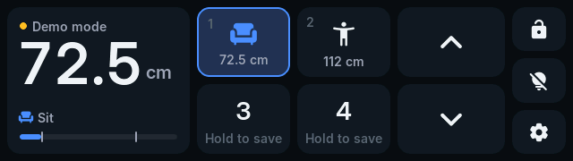
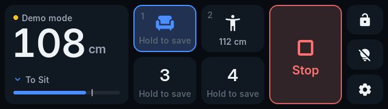
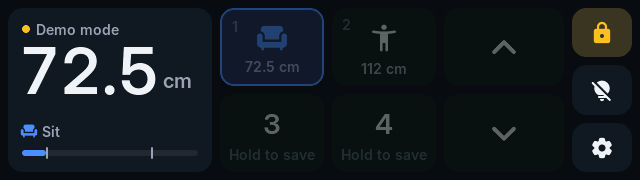
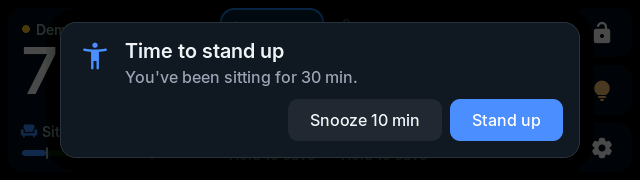
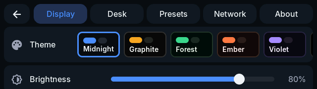
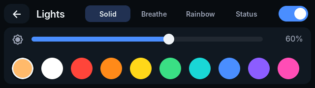
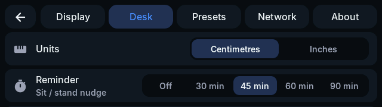
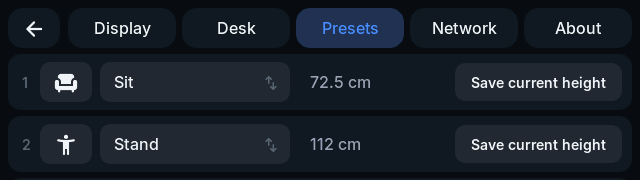
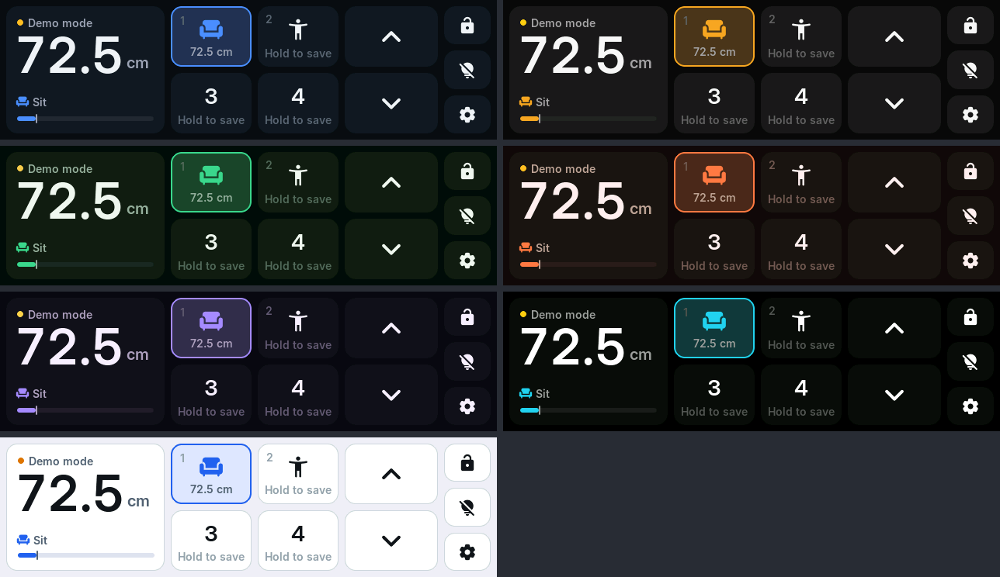

# Smart Desk Controller

A replacement handset for a **Flexispot E7 Pro** (LoctekMotion control box), running on a **LilyGO T-Display-S3-Long** (ESP32-S3, 3.4" 640×180 touch display). It adds:

- a themeable dark-mode touch UI
- Home Assistant integration over MQTT
- addressable LED strip control




## Features

- **Desk control:**
  - hold-to-move up/down
  - 4 presets: tap to go, hold to save
  - a large Stop button while the desk travels to a preset
  - live height with a travel gauge and preset markers
- **Child lock:** tap 🔒 to lock; hold it for about 1.5 s to unlock. Locking also stops a desk in motion.
- **Desk states:** detects the control box's own lock (`LoC`), error codes (`E01`…) and reset state (`ASr`), and shows guidance.
- **Sit/stand reminder:** a configurable nudge with one-tap "Stand up / Sit down".
- **Display:** 7 themes, brightness, auto-dim, screen-off, rotate 180°. The first touch on a dimmed or sleeping screen only wakes it.
- **Safety:**
  - touch glitches are debounced
  - Up/Down only drive after 150 ms of continuous press
  - sliding off a button stops the desk
  - held keys auto-release in the protocol layer if the UI stops refreshing them
  - a preset tap can never overwrite a preset while the box is still armed by M
  - demo mode can't be switched and the controller won't restart while the desk is moving
  - retained MQTT commands are ignored
- **LED strip:** on/off, brightness, colour, and Solid, Breathe, Rainbow and Desk status effects.
- **Home Assistant (MQTT discovery):**
  - height, motion, standing and link sensors
  - preset, stop and nudge buttons
  - child-lock switch
  - RGB light with effects
  - theme, brightness, reminder and demo-mode controls
- **Demo mode:** a simulated control box that speaks the real protocol, so everything works before the desk is wired.
- **Desktop simulator and tests:** the same UI and logic run on macOS/Linux, driven by scripts that take screenshots and check behaviour.

| | |
|---|---|
|  |  |
|  |  |
|  |  |

All seven built-in themes:



## Project layout

```
components/
  desk/        Portable LoctekMotion protocol: CRC, framing, 7-segment decode,
               key timing controller, simulated control box
  app_core/    Portable application state: settings, presets, lock, reminder, events
  ui/          Portable LVGL UI: theme system, widgets, home/settings/lights screens,
               generated fonts (Inter + Material Symbols)
  board/       T-Display-S3-Long drivers: AXS15231B QSPI panel, touch, PMU, backlight
main/          ESP-IDF glue: LVGL port, NVS settings, desk UART, LEDs, Wi-Fi/MQTT/HA,
               USB console
sim/           Desktop simulator (SDL2 window or headless scripted screenshots)
test/host/     Unit tests for protocol, controller and app logic
tools/         devtool.py (serial console, screenshots), font generator, image script
docs/          desk-protocol.md, hardware.md, images/
```

Portable code (`desk`, `app_core`, `ui`) has no ESP-IDF dependencies. The firmware and the simulator compile the same sources.

## Building and flashing

This needs ESP-IDF **v6.1**. It is already installed on this machine at `~/.espressif/v6.1`.

```sh
source ~/.espressif/tools/activate_idf_v6.1.sh
idf.py build
idf.py -p /dev/cu.usbmodem* flash monitor
```

Pins, LED count, network defaults and demo mode are under `idf.py menuconfig` → **Smart Desk Controller**. See [docs/hardware.md](docs/hardware.md) for wiring.

## Desktop simulator and tests

This needs CMake, a C++20 compiler, zlib, and optionally SDL2 (`brew install sdl2`). LVGL comes from `managed_components/` after the first `idf.py build`, or is fetched automatically.

```sh
cmake -S sim -B build-sim -DCMAKE_BUILD_TYPE=Release && cmake --build build-sim -j

./build-sim/desk_tests                                   # protocol / controller / app unit tests
./build-sim/desk_sim                                     # interactive window: mouse = finger,
                                                         #   S = screenshot, T = next theme
./build-sim/desk_sim --script sim/scripts/ui_test.sim    # functional UI test (touch-driven, asserts state)
sim/run_tests.sh                                         # everything above, headless
```

Script commands include:

- **Input:** `tap x y [ms]`, `press`, `move`, `release`, `drag`
- **Timing and capture:** `wait ms`, `shot name`
- **State:** `set key value`, `theme n`, `page home|settings|lights`
- **Desk simulation:** `desk_height cm`, `desk_text E01 ms`, `unplug`/`plug`
- **Assertions:** `expect …`

Coordinates are in the 640×180 landscape space. `tools/make_readme_images.sh` regenerates the screenshots in this README.

## USB console

The board's USB-C port is also a serial console. Use any terminal at 115200 baud, or the helper:

```sh
tools/.venv/bin/python tools/devtool.py cmd "help"
tools/.venv/bin/python tools/devtool.py shot screen.png   # screenshot of the live display
tools/.venv/bin/python tools/devtool.py tap 504 47        # inject a touch (landscape coords)
```

The helper needs `python3 -m venv tools/.venv && tools/.venv/bin/pip install pyserial pillow`.

| Command | Purpose |
|---|---|
| `state` | Desk link, height, motion, box display, frame counters, settings, presets |
| `stats` | Heap, render and transfer timings, touch chip, rejected touch glitches |
| `desk up\|down [ms]`, `desk stop`, `desk preset N`, `desk save N` | Drive the desk |
| `desk boxlock` | Hold M for 5.5 s (toggles the control box's own lock) |
| `desk keys <hex> [ms]`, `desk wake` | Send a raw key mask; pulse the wake pin |
| `desk demo on\|off` | Switch between the simulated and the real desk |
| `sniff [s] [all]` | Print raw protocol frames with decoded display text |
| `lock on\|off`, `set theme\|brightness\|dim\|sleep\|rotate\|units\|reminder <v>` | Settings |
| `preset N name <text>`, `preset N icon <0-4>` | Rename a preset or change its icon (0 number, 1 sit, 2 stand, 3 walk, 4 focus) |
| `wifi <ssid> <password>`, `mqtt <uri> [user] [password]`, `name <text>`, `net [forget]` | Network and Home Assistant setup |
| `shot`, `tap`, `drag`, `touch [s]`, `page …`, `backlight`, `reg` | UI and diagnostics |
| `reboot` | Stops the desk, then restarts |

## Home Assistant

1. Make sure an MQTT broker is running (e.g. the Mosquitto add-on) with the MQTT integration enabled.
2. Over the USB console, run:
   ```
   wifi MyNetwork MyPassword
   mqtt mqtt://homeassistant.local mqtt_user mqtt_password
   name Office Desk
   ```
3. The desk appears under **Settings → Devices** as *Office Desk*.

Topics live under `smartdesk/<id>/…`, and discovery configs under `homeassistant/<component>/smartdesk_<id>/…`. Height is published in cm. Preset names and heights are attributes of the height sensor.

## Themes

A theme is plain colour data. To add one, append a `Palette` to `kPalettes` in [`components/ui/themes.cpp`](components/ui/themes.cpp):

```cpp
{
    .name = "Sunset",
    .dark = true,
    .bg = hex(0x120B10), .surface = hex(0x1E1419), .surface_2 = hex(0x2A1C23), .border = hex(0x3A2830),
    .text = hex(0xFBEFF3), .text_muted = hex(0xBFA3AE), .text_faint = hex(0x735A64),
    .accent = hex(0xFF6B8B), .on_accent = hex(0x1A0509),
    .positive = hex(0x6EE7B7), .warning = hex(0xFBBF24), .danger = hex(0xFF5A5F),
},
```

It then shows up automatically in **Settings → Display** and in Home Assistant's theme selector.

**How theming works:**
- Every widget is styled only through the shared `lv_style_t` objects in [`theme.cpp`](components/ui/theme.cpp).
- Switching theme refills those styles and refreshes; no screens are rebuilt.
- Derived colours (tinted selections, pressed states) are computed from the palette.
- New widgets should use `theme::styles()` rather than local colours, so they follow theme changes.

## Regenerating fonts

The UI uses Inter (OFL) with tabular digits for the height readout, plus Material Symbols Rounded (Apache 2.0) icons, pre-rendered as 4 bpp LVGL fonts.

1. Add icons to `ICONS` in `tools/fonts/generate_fonts.py`.
2. Run:
   ```sh
   python3 -m venv tools/.venv && tools/.venv/bin/pip install fonttools opentype-feature-freezer
   tools/.venv/bin/python tools/fonts/generate_fonts.py   # needs node/npx for lv_font_conv
   ```

Icons are then available as `UI_ICON_<NAME>` string literals.

## Connecting the desk

Read [docs/desk-protocol.md](docs/desk-protocol.md) before plugging in. It covers:

- the RJ45 pinout and voltage levels (the box TX may be 5 V)
- the timing this firmware uses and which parts are still unverified
- a step-by-step first-connection checklist using `sniff`

Demo mode is on by default; turn it off in **Settings → Desk** once the desk is wired.

## Licences

Fonts: Inter (SIL OFL 1.1) and Material Symbols (Apache 2.0). Licence texts are in `components/ui/fonts/`.
